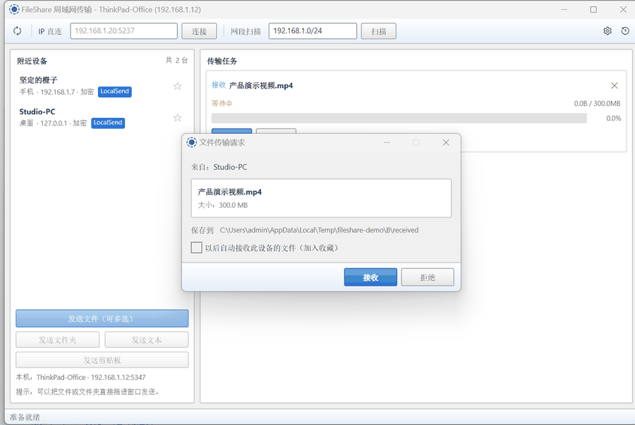
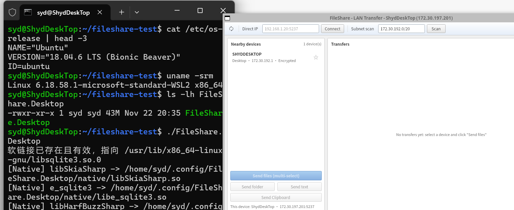

# FileShare

FileShare 是一款面向局域网的点对点文件传输工具：设备之间直连传输，不经过云端、不需要账号，打开即用。桌面端基于 Avalonia，移动端基于 .NET MAUI，并可与 LocalSend 客户端互通。

## 界面预览

从接收确认，到传输过程，再到接收完成：

Linux（Ubuntu 18.04.6 LTS + WSLg）：AOT 单文件版本，在终端中直接执行 `./FileShare.Desktop` 启动，终端内可见 `Ubuntu 18.04.6 LTS`、Linux 内核版本与启动命令：

## 主要功能

**设备发现**

- 自动发现同一局域网内的设备：UDP 广播、mDNS、LocalSend 组播多路并行
- 支持手动输入 IP 或 `IP:端口` 直连
- 支持按网段扫描
- 可收藏常用设备，下次直接发送

**文件传输**

- 发送文件、文件夹、文本和剪贴板内容
- 支持多文件与整个目录，大文件稳定传输
- 多任务并行传输，可暂停、继续、取消
- 可设置上传限速，避免占满带宽
- 同名文件支持覆盖、跳过、重命名等冲突处理
- 完整的传输历史记录

**安全**

- HTTPS/TLS 加密传输
- 基于证书指纹校验对端身份（首次信任，后续变更会提示）
- 接收前可确认文件列表与大小，可选择仅信任收藏设备

**跨平台互通**

- Windows 桌面端、Linux 桌面端
- Android / iOS 移动端
- 与 LocalSend 客户端双向互通，可直接收发

**使用体验**

- 中文界面，支持界面皮肤切换
- 最小化到托盘，支持单实例运行
- 内置网页分享，浏览器即可下载
- 数据全部保存在本地

## 平台支持

- **Windows**：适用于 Windows 10 / 11；借助 AOT 发布配合 YY-Thunks 与 VC-LTL，可在未打任何补丁的 Windows 7 RTM 上运行
- **Linux**：提供 AOT 单文件版本，无需安装 .NET 运行时；已在 Ubuntu 18.04.6 LTS（WSLg）实际运行，理论上支持 glibc 2.27 及以上（以 Ubuntu 18.04 构建基线为准；Avalonia/Skia 自身最低要求为 glibc 2.17）
- **macOS**：理论上支持 macOS 14 Sonoma 及以上，x64（Intel）与 ARM64（Apple Silicon）两种架构
- **Android / iOS**：基于 .NET MAUI 的移动客户端，可使用同一套传输能力
